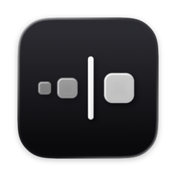

# Tuck



把 macOS 菜单栏上用不到的图标藏起来，只做这一件事。藏图标的原理照搬 [Ice](https://github.com/jordanbaird/Ice)，其余功能都去掉了。不需要任何系统权限。

## 安装

```sh
scripts/install.sh
```

## 使用

- 菜单栏上有一个箭头 `<`。点一下展开，左边会多出一条竖线 `|`，再点一下就收起来。
- **竖线左边的图标会被藏起来。** 按住 ⌘ 把图标拖到竖线左边或右边，就能决定哪些藏、哪些留。
- 展开 10 秒后自动收起；鼠标还停在菜单栏上，或者有菜单开着的时候，会等一等再收。
- 右键箭头：开机启动、退出。

## 原理

竖线本身也是一个菜单栏图标。收起时把它的宽度撑到 10000，它左边的图标就被挤出屏幕。如果竖线被拖到了箭头右边，Tuck 不会收起，免得把箭头也挤没了。

## 图标

`Resources/Tuck.icon` 是 Icon Composer 工程，图层由 `swift scripts/make-icon.swift Resources/Tuck.icon/Assets` 画出来，打包时用 `actool` 编译。圆点上的蓝牙、Wi-Fi、云、铃铛符号来自 [Lucide](https://lucide.dev)（ISC 协议，见 `Resources/glyphs/LICENSE`），线条加粗到 2.6。

## 协议

Tuck 按 [PolyForm Noncommercial License 1.0.0](LICENSE.md) 发布：源码公开，可用于个人和其他非商业用途，不允许商业使用。如需商业授权，请联系作者。图标里的符号来自 Lucide，按它自己的 ISC 协议使用（见 `Resources/glyphs/LICENSE`）。
